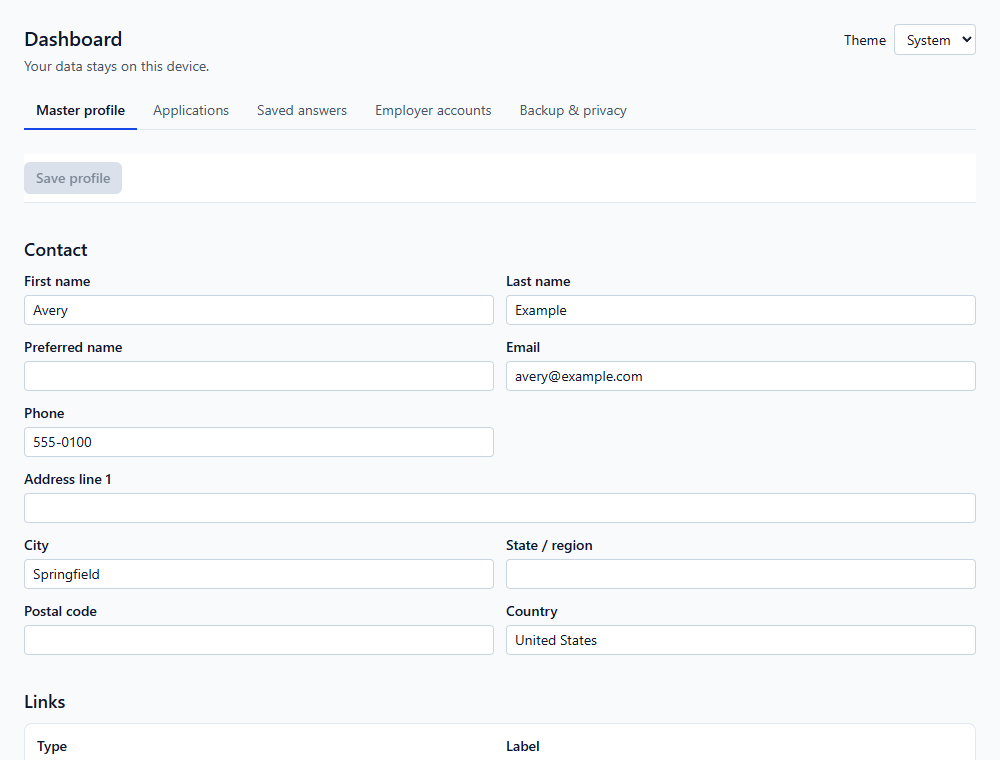
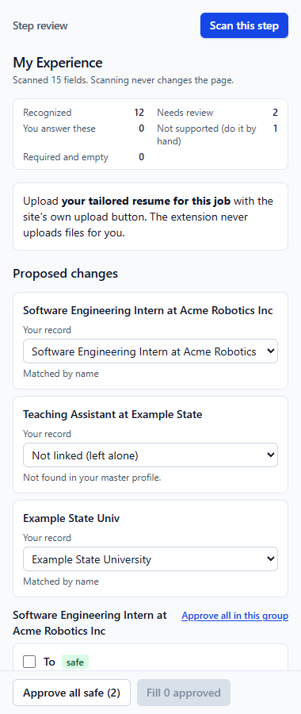
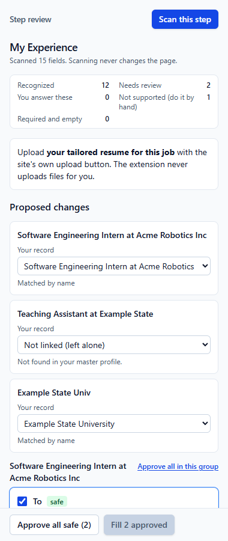

# Job Application Copilot

A Chrome extension that proposes job-application answers from a verified profile. You review the changes before it fills them. Navigation, uploads, signatures, and submission stay manual.

It runs locally, with no backend, analytics, or AI service. The master profile stays separate from tailored resume imports and individual application records.

## Platform support and status

| Platform | Implemented scope | Evidence and limits |
| --- | --- | --- |
| Workday | Candidate portals, step scanning, approved filling, experience repair, and verified-list skill search | Recorded manual QA on selected employers and synthetic regression fixtures. Custom domains and employer-specific controls can remain unsupported. |
| Greenhouse | Hosted boards on `job-boards.greenhouse.io` | Recorded QA on selected boards. Employer-site embedded forms are not supported. |
| Ashby | Application pages on `jobs.ashbyhq.com` | Adapter and synthetic tests, plus a recorded application QA session. Overview pages do not contain the supported form. Free-text sensitive answers remain manual. |

The project is experimental. [Redacted QA notes](docs/qa/) record observed failures and fixes. Automated tests reproduce selected cases on synthetic pages; they are not exhaustive employer compatibility checks. The [implementation ledger](docs/implementation-progress.md) includes historical phase notes, some of which predate the later live QA.

The current review candidate adds application-specific record selection and approved wording, conflict-safe application saves, larger restorable backups, and verified entry additions. Fresh live QA of these changes is pending. See the [candidate checklist](docs/release-candidate.md) and [changelog](CHANGELOG.md).

“Filled and verified” means the page shows the expected value after the write. It cannot confirm a portal's internal store or successful submission. Ashby exposed a case where visible answers had not reached that store; the adapter now spaces out writes, with a regression fixture reproducing the race.

## Architecture

The write path is scan, propose, preview, approve, revalidate, apply, then verify.

| Boundary | Responsibility |
| --- | --- |
| Domain | Validated records, normalization, matching, and answer policy |
| Platform adapters | Site detection and platform-specific scan/fill/verify controls |
| Review interface | Proposed value, current value, source, reason, and approval |
| Injected page script | Only the approved fill plan, not the complete master profile |
| Service worker | Local storage ownership, validated messages, revisions, and migrations |

The release requests `activeTab`, `scripting`, `storage`, and `sidePanel`, with no static host permissions. A site is accessed only after activation. See [architecture](docs/architecture.md) and the [adapter guide](docs/adding-an-adapter.md).

## What it does

- Keeps one verified master profile (contact, links, education, jobs, projects, skills) and a separate record for each application.
- Imports your tailored resume as a PDF, a companion JSON from your resume chat, or both. It reads them on your device, flags mismatches, and shows how each differs from your master profile. Your master profile stays the source of truth.
- Scans each Workday step without changing it, then proposes fills: only fields that differ from your profile, each with its source and reason.
- Repairs My Experience: matches Workday's parsed entries to your real jobs and schools by identity, never by position. It fixes dates and dropdowns, and adds missing entries only when you approve.
- Lets you select jobs, schools and projects per application and review its employment/project wording. Enable **Application content**, edit or copy imported wording, verify the selections, and save. Factual names, titles and dates still come from the master profile. Excluded entries already on the page stay untouched. Project wording is available in step review for manual entry.
- Adds skills only from your verified list. It searches Workday's skills box, picks exact matches, offers close options for your approval, and tells you honestly when a skill isn't available.
- Remembers answers only when you click Remember, scoped to all employers, one employer or one job. It never reuses an answer for reversed wording.
- Sensitive answers (demographics, work authorization, sponsorship, conviction) are filled only from answers you type in the dashboard. Approve individual fields or explicitly approve their group (accepted for personal use); **Approve all safe** excludes them. The question, or otherwise its choices, must clearly name the topic, and the visible choice must exactly match a saved wording.
- Helps with accounts: it recognizes sign-in and registration pages and keeps an account list (email and status only), but never types or reads passwords, codes or Google sign-in.
- Respects your edits: the write path rechecks field identity and current value before applying a proposal, then checks the displayed result after the page rerenders. A stale plan or detected user edit is refused.

## What it never does

The extension does not click Next or Submit, accept terms, sign attestations, create accounts, sign in, or upload files. Passwords, one-time codes, CAPTCHA, cookies, and SSO stay outside its workflow. It does not infer skills, dates, or experience from a job description or send profile data to a backend.

## Install (from source)

Requires Node 22 and npm.

```bash
npm ci
```
```bash
npm run build
```

1. Open `chrome://extensions` and turn on **Developer mode**.
2. Click **Load unpacked** and choose `.output/chrome-mv3`.
3. Pin the extension. After updating the code, rebuild and click ↻ on the extension card. Your data is kept.

`npm run zip` builds a local package under `.output/`. It isn't published to any store.

## Using it on an application

1. **Dashboard → Master profile:** enter your verified details.
2. **Dashboard → Applications → New application:** add the tailored PDF and/or JSON (see [docs/chatgpt-resume-handoff.md](docs/chatgpt-resume-handoff.md)), review the comparison, and save.
3. Open a supported application page. On Workday, use its own "Autofill with Resume" if available. Upload the PDF yourself on every platform.
4. Click the extension button, choose the application, and click **Activate on this tab**. Then click **Open step review**.
5. **Scan this step**, read the proposed changes, approve what's right (or "Approve all safe"), and click **Fill**. Each field reports "Filled and verified" or why it wasn't filled.
6. Answer anything listed under "You answer these" yourself. Click Next yourself; the panel re-scans the new step.
7. On the confirmation page, record the submission if you want it in your history.

The full manual QA checklist is in [docs/manual-testing.md](docs/manual-testing.md).

## Privacy

Your data is stored only in this Chrome profile (`chrome.storage.local`, restricted to the extension's own pages). Chrome doesn't encrypt it, so anyone with access to your computer account could read it. Export backups and delete data from **Dashboard → Backup & privacy**. Job descriptions are saved only if you tick the box. Details: [docs/privacy-threat-model.md](docs/privacy-threat-model.md).

Backups use compact JSON with a 12 MB import limit; Chrome's local-storage quota still applies. The candidate upgrades stored records to schema 6. Export a backup with your previous build before updating if you need the option to return to it; older schema-5 builds cannot read schema-6 data.

Permissions: `activeTab` (only the tab you activate, until it navigates away), `scripting`, `storage`, `sidePanel`. No access to sites until you click Activate.

## Development

```bash
npm run typecheck && npm run lint && npm run build && npm test && npm run test:e2e
```

- `npm run test:e2e` builds a test-only variant into `.output/chrome-mv3-e2e` (it grants the synthetic fixture hosts) and drives it in Playwright's Chromium. The release build excludes those grants, with a manifest regression check.
- Recent live findings cover Workday skills pop-ups with their own search boxes and Ashby's form-store update timing. Review [known limitations](docs/known-limitations.md) alongside the newer QA notes; older blanket “untested live” statements predate recorded sessions.
- Architecture: [docs/architecture.md](docs/architecture.md). Limitations: [docs/known-limitations.md](docs/known-limitations.md). Conventions for contributors and coding agents: [AGENTS.md](AGENTS.md).
- Regenerate fixture PDFs: `node scripts/make-fixture-pdfs.ts`.

## Screenshots

These use fabricated data only.

The [application content screenshot](docs/screenshots/application-content.png) shows selected records and approved wording in the review candidate.

| Dashboard | Step review | Proposed changes |
|---|---|---|
|  |  |  |

## License

MIT
